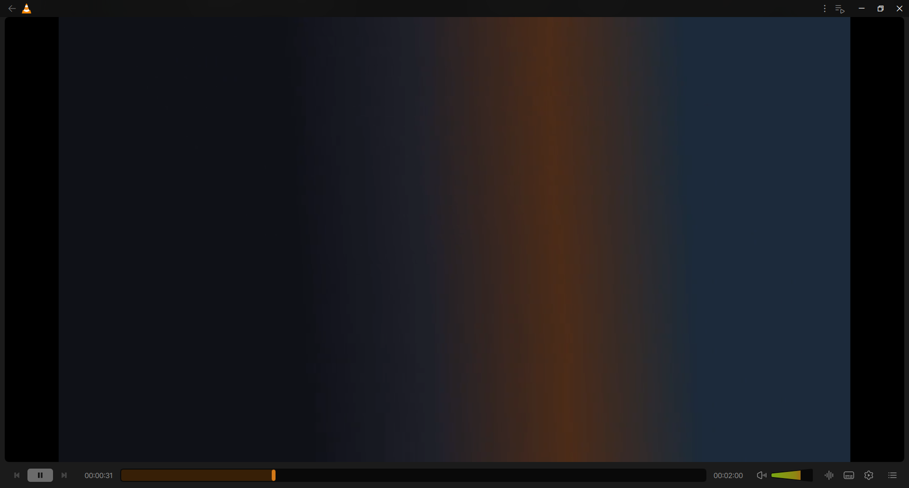
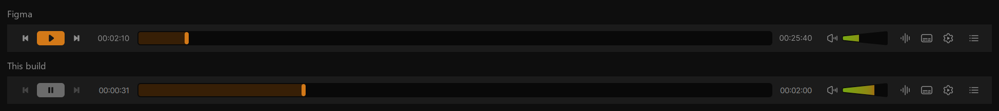
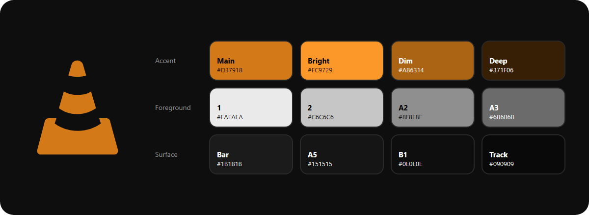

# VLC Redesign

An unofficial, work-in-progress redesign of the **VLC media player** interface, built 1:1 in VLC's own Qt/QML
interface. Playback, codecs and everything else stay VLC; only how it looks and feels changes.

**The design is 100% based on Juxtopposed's video
[*I Redesigned VLC After 25 Years*](https://www.youtube.com/watch?v=ERFeOgqk324).** Every layout, size, colour and
icon comes from the Figma file ("VLC Redesign", community) shown in that video, and nothing here is original design
work. This project is not affiliated with or endorsed by VideoLAN or Juxtopposed.

> **Status: in progress.** The bottom control bar is built; the rest of the interface still looks like stock VLC.
> See [Roadmap](#roadmap).

## What it looks like today



*Windowed player with pinned controls, playing a plain generated test clip. The top bar is still stock VLC; it is
Phase 3.*

The control bar next to the Figma frame it is built from (same 1920 px width, so positions line up):



*The time, the seek position and the pause glyph differ only because the two were captured at different moments.*

## Progress so far

Done and checked against the Figma frame by capturing the running app:

- **Control bar layout:** previous / play / next at the bottom left (30, 54 and 30 px slots), seek bar between the
  time labels, volume group, then audio, subtitles, settings and lists. Positions match Figma within 1 to 2 px.
  The layout is profile-driven, so the bar stays customisable.
- **Time labels:** Inter 15 px in `HH:MM:SS`.
- **Play and pause:** drawn from the Figma components (orange play, grey pause).
- **Seek bar:** Figma track, played colour, inset and handle; no tooltip or buffer block; dragging to the far left
  reaches `00:00:00`.
- **Cone volume slider:** Figma cone, gradient fill and overlay; the end of the cone is VLC's maximum volume. The
  level is shown in the Figma audio value box above the cone while it is hovered or changed.
- **Seek preview:** hovering the seek bar shows the frame at that position and its time above the bar (Figma
  thumbnail card, generated by VLC's thumbnailer; the card's blur is not drawn).
- **Windowed video frame:** with `--qt-pin-controls` the video sits in the dark rounded Figma frame.
- **Icons:** the control bar uses the Figma icons, and the whole set (206 SVGs) is collected in
  [`design/figma-icons`](design/figma-icons) for the next screens. The eight two-tone menu header icons are added
  but not placed in any menu yet.

Placed but not working yet: the audio and subtitles buttons (they show the icon and do nothing until Phase 4).

## Roadmap

Each feature is one commit, checked by capturing the running app and comparing it with the matching Figma frame
(source | render | difference), not by eye.

### Phase 1: Design tokens and foundations
- [ ] **Colour palette and theme tokens.** Colours are collected in [`design/palette`](design/palette) and used in
  the control bar; still to do: apply them app-wide as theme tokens.
- [ ] **Icon system foundation.** Monochrome control icons are in use in the bottom bar; the two-tone menu header
  icons exist but replace the stock ones screen by screen as those screens are built.

### Phase 2: Main playback controls and bottom bar
- [x] **Playback controls layout.** Play/pause at the bottom left, previous and next flanking it. Fullscreen leaves
  the bottom bar and comes back in the top bar (Phase 3).
- [ ] **Queue vs playlist toggle.** The queue icon is in; drag-and-drop ingestion and the quick add-file icons are
  still to do.
- [x] **Deformed cone volume slider.**
- [x] **Thick bottom seek bar and hover preview.** The bar and the frame preview above it while hovering are done.

### Phase 3: Top navigation bar and window chrome
- [ ] **Top overlay and hover behaviour.** Auto-hiding top and bottom bars with independent hover triggers; the top
  bar carries the title, window controls, fullscreen and picture-in-picture.

### Phase 4: Audio, subtitle and track management flyouts
- [ ] **Quick audio and subtitle popovers.**
- [ ] **Enhanced subtitle loader dialog.**

### Phase 5: Quick settings sidebar
- [ ] **Four-tab right sidebar** (Subtitles, Audio, Video, Playback).

### Phase 6: Media library, music player and stream browser
- [ ] **Top-title quick library switcher.**
- [ ] **Dedicated music mode view.**
- [ ] **Stream and playlist manager.**

### Phase 7: Settings overhaul and onboarding
- [ ] **Hotkeys dialog.**
- [ ] **Consolidated settings tree.**
- [ ] **Customisation and onboarding system.**

## Design assets

[`design/`](design/) is a library to pick from while building screens. Nothing in it is compiled into VLC.

- [`design/figma-icons/`](design/figma-icons/): all 206 Figma icon variants as SVG, with a contact sheet
  (`index.html`) and a machine-readable index.
- [`design/palette/`](design/palette/): the colour sheet as shown in the video next to the matching Figma paint
  styles, and every Figma style as JSON.



Figma is the only reference for sizes, colours and icons. Video frames are used for orientation only, because the
video is compressed and its colours drift by a few values.

## Building and running

This is VLC's code base with changes limited to `modules/gui/qt/` (QML, a few C++ files, icons and a bundled font).
Build it as you would VLC: see [`INSTALL`](INSTALL) and the
[VLC build guides](https://wiki.videolan.org/Category:Building). Qt 6 is required.

Useful flags while developing:

- `--qt-pin-controls` pins the controls under the video (needed to see the video frame).
- `--no-qt-privacy-ask` skips the first-run privacy dialog.

## Branches

- `redesign`: the redesign, as one commit per finished and verified feature, on top of upstream VLC.
- `master`: a plain mirror of upstream VLC (`code.videolan.org/videolan/vlc`), so syncing upstream is a
  fast-forward and the redesign is rebased on it.

## Credits and licence

- VLC is by the VideoLAN community and is released under the GPLv2 (or later); libVLC under the LGPLv2 (or later).
  The redesign is released under the same licences.
- [Inter](https://rsms.me/inter/) 4.0 is bundled for the time labels under the SIL Open Font License
  (`modules/gui/qt/pixmaps/Inter-LICENSE.txt`).
- The design, including the Figma icons and colours, is Juxtopposed's work from the video above. Check the Figma
  file's licence before reusing them outside this project.

---

# About VLC (upstream README)

# VLC media player

**VLC** is a libre and open source **media player** and **multimedia engine**,
focused on **playing everything**, and **running everywhere**.

**VLC** can play most multimedia files, discs, streams, devices and is also able to
convert, encode, **stream** and manipulate streams into numerous formats.

VLC is used by many over the world, on numerous platforms, for very different use cases.

The **engine of VLC** can be embedded into 3rd party applications, and is called *libVLC*.

**VLC** is part of the [VideoLAN project](https://videolan.org) and
is developed and supported by a community of volunteers.

The VideoLAN project was started at the university [École Centrale Paris](https://www.centralesupelec.fr/) who
relicensed VLC under the GPLv2 license in February 2001. Since then, VLC has
been downloaded **billions** of times.

## License

**VLC** is released under the GPLv2 *(or later)* license.
*On some platforms, it is de facto GPLv3, because of the licenses of dependencies*.

**libVLC**, the engine is released under the LGPLv2 *(or later)* license. \
This allows embedding the engine in 3rd party applications, while letting them to be licensed under other licenses.

# Platforms

VLC is available for the following platforms:
- [Windows] *(from 7 and later, including UWP platforms and all versions of Windows 10)*
- [macOS] *(10.10 and later)*
- [GNU/Linux] and affiliated
- [BSD] and affiliated
- [Android] *(4.2 and later)*, including Android TV and Android Auto
- [iOS] *(9 and later)*, including AppleTV and iPadOS
- Haiku, OS/2 and a few others.

[Windows]: https://www.videolan.org/vlc/download-windows.html
[macOS]: https://www.videolan.org/vlc/download-macosx.html
[GNU/Linux]: https://www.videolan.org/vlc/#download
[BSD]: https://www.videolan.org/vlc/download-freebsd.html
[Android]: https://www.videolan.org/vlc/download-android.html
[iOS]: https://www.videolan.org/vlc/download-ios.html

Not all platforms receive the same amount of care, due to our limited resources.

**Nota Bene**: The [Android app](https://code.videolan.org/videolan/vlc-android/) and
the [iOS app](https://code.videolan.org/videolan/vlc-ios/) are located in different repositories
than the main one.

# Contributing & Community

**VLC** is maintained by a community of people, and VideoLAN is not paying any of them.\
The community is composed of developers, helpers, maintainers, designers and writers that want
this open source project to thrive.

The main development of VLC is done in the C language, but this repository also contains
plenty of C++, Obj-C, asm and Rust.

Other repositories linked to vlc are done in languages including Kotlin/Java [(Android)](https://code.videolan.org/videolan/vlc-android/),
Swift [(iOS)](https://code.videolan.org/videolan/vlc-ios/), and C# [(libVLCSharp)](https://code.videolan.org/videolan/libvlcsharp/).

We need help with the following tasks:
- Coding
- Packaging for Windows, macOS and Linux distributions
- Technical writing for the documentation
- Design
- Support
- Community management and communication.

Please contribute :)

We are on IRC. You can find us on the **#videolan** channel on *[Libera.chat]*.

[Libera.chat]: https://libera.chat

## Contributions

Contributions are now done through Merge Requests on our [GitLab repository](https://code.videolan.org/videolan/vlc/).

CI and discussions should be resolved before a Merge Request can be merged.

# libVLC

**libVLC** is an embeddable engine for 3rd party applications and frameworks.

It runs on the same platforms as VLC *(and sometimes on more)* and can provide playback,
streaming and conversion of multimedia files and streams.


**libVLC** has numerous bindings for other languages, such as C++, Python and C#.

# Support

## Links

Some useful links that might help you:

- [VLC web site](https://www.videolan.org/vlc/)
- [Support](https://www.videolan.org/support/)
- [Forums](https://forum.videolan.org/)
- [Wiki](https://wiki.videolan.org/)
- [Developer's Corner](https://wiki.videolan.org/Developers_Corner)
- [VLC hacking guide](https://wiki.videolan.org/Hacker_Guide)
- [Bugtracker](https://code.videolan.org/videolan/vlc/-/issues)
- [VideoLAN web site](https://www.videolan.org/)

## Source Code sitemap
```
ABOUT-NLS          - Notes on the Free Translation Project.
AUTHORS            - VLC authors.
COPYING            - The GPL license.
COPYING.LIB        - The LGPL license.
INSTALL            - Installation and building instructions.
NEWS               - Important modifications between the releases.
README             - Project summary.
THANKS             - VLC contributors.

bin/               - VLC binaries.
bindings/          - libVLC bindings to other languages.
compat/            - compatibility library for operating systems missing
                     essential functionalities.
contrib/           - Facilities for retrieving external libraries and building
                     them for systems that don't have the right versions.
doc/               - Miscellaneous documentation.
extras/analyser    - Code analyser and editor specific files.
extras/buildsystem - Different build system specific files.
extras/misc        - Files that don't fit in the other extras/ categories.
extras/package     - VLC packaging specific files such as spec files.
extras/tools/      - Facilities for retrieving external building tools needed
                     for systems that don't have the right versions.
include/           - Header files.
lib/               - libVLC source code.
modules/           - VLC plugins and modules. Most of the code is here.
po/                - VLC translations.
share/             - Common resource files.
src/               - libvlccore source code.
test/              - Testing system.
```
